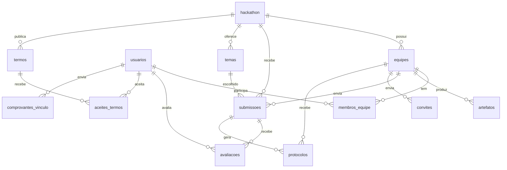
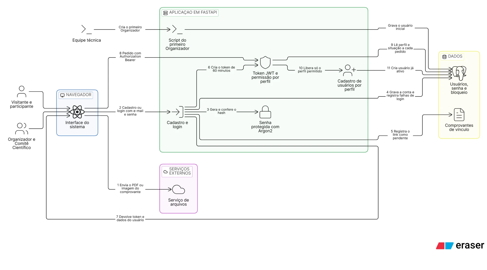
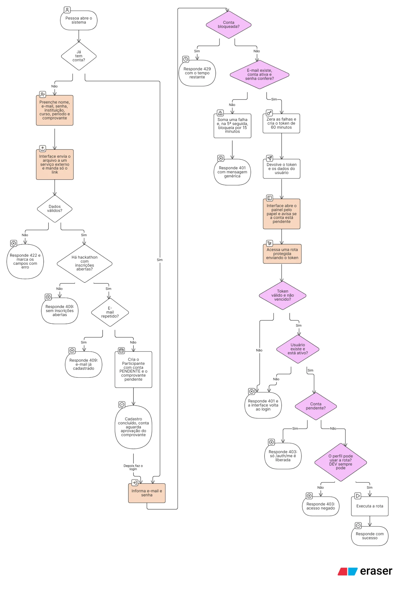

# Hackathon — Backend

API do sistema de gestão de hackathons. Feita com **FastAPI + SQLModel (async) + PostgreSQL 17 + Flyway + Poetry + Docker Compose**.

## Situação atual

- [x] Estrutura do projeto, Docker, CI
- [x] Banco: tabelas e enums (migration `V202610110000__init.sql`)
- [x] Banco: fluxos de inscrição e proposta e perfis de acesso do RF06 (migration `V202610261200__fluxos_inscricao_proposta.sql`)
- [x] Models (SQLModel) e schemas (Pydantic) de todas as entidades
- [x] Banco: senha, bloqueio de login e situação da conta (migration `V202610261400__autenticacao_usuarios.sql`)
- [x] Autenticação e permissões: cadastro, login, perfis e cadastro de usuários (ver [Autenticação e permissões](#autenticação-e-permissões))
- [ ] Controllers e rotas (CRUD) das demais entidades — por enquanto a API só tem `/health` e as rotas de autenticação

## Rodando o projeto

Pré-requisitos: Docker com o plugin `docker compose`. O `make` é opcional — ele é só um atalho, e a seção [Comandos](#comandos) traz o equivalente em `docker compose` de cada alvo (no Windows o `make` não vem instalado).

```bash
git clone https://github.com/lthiago849/hackathon-backend.git
cd hackathon-backend
make env    # cria o .env a partir do .env.example
make up     # sobe db, flyway (migrations), app e pgadmin
```

Sem o `make`, os dois comandos acima são:

```bash
cp .env.example .env
docker compose up -d --build
```

| Serviço         | Endereço                        | Acesso                                          |
|-----------------|---------------------------------|-------------------------------------------------|
| API (Swagger)   | http://localhost:8000/docs      | —                                               |
| Health          | http://localhost:8000/health    | —                                               |
| pgAdmin         | http://localhost:`PGADMIN_PORT` | `admin@example.com` / `admin`                   |
| Postgres        | `localhost:POSTGRES_PORT`       | `postgres` / `postgres`, banco `POSTGRES_DB`    |

- No pgAdmin, registre o servidor com host **`db`** e porta **`5432`** (ele roda dentro da rede do Docker).
- Pelo terminal: `make db-shell` abre o `psql` já conectado.
- **Os testes usam outro banco.** Junto com o `POSTGRES_DB`, o compose cria o `POSTGRES_DB_test` (ex.: `hackathon_db_test`) no mesmo Postgres e aplica nele as migrations. O `pytest` troca para esse banco sozinho (`tests/__init__.py`) e um teste confere isso, então rodar os testes nunca mexe nos dados de desenvolvimento. Para inspecionar o banco de testes, conecte no `psql` ou no pgAdmin com o nome `<POSTGRES_DB>_test`. No CI, o banco `app_db_test` é criado antes das migrations.

> **Portas ocupadas?** Se outro projeto já usa a 5432/4040/8000, mude `POSTGRES_PORT`, `PGADMIN_PORT` e `APP_PORT` no `.env` (ex.: 5434 e 4041) e rode `make up` de novo.

## Modelo de dados



| Tabela                 | Descrição                                                                                     |
|------------------------|-----------------------------------------------------------------------------------------------|
| `usuarios`             | Pessoas do sistema; `email` único, `papel`, `ativo`, instituição, curso e período; dados do mentor (empresa, área, máx. de equipes); `senha_hash` (Argon2), `tentativas_login`, `bloqueado_ate` e `situacao_conta` |
| `hackathon`            | Edição do evento: datas, `status`, tamanho da equipe (`min/max_integrantes`) e prazos da Fase 1 |
| `equipes`              | Equipes de um hackathon, com a `situacao` (Em formação → Homologada)                           |
| `membros_equipe`       | Usuário ↔ equipe com a `funcao`; uma equipe por pessoa em cada hackathon e um único `LIDER`     |
| `convites`             | Integrantes informados pelo líder (nome e e-mail) aguardando confirmação                       |
| `termos`               | Regulamento e termo de consentimento, versionados; uma versão vigente por tipo                 |
| `aceites_termos`       | Aceite de um usuário a uma versão de termo, com data e hora                                    |
| `comprovantes_vinculo` | Comprovante de vínculo e a conferência do Comitê Científico; reenvio cria uma linha nova       |
| `temas`                | Temas do edital, com ODS relacionados e `ativo`                                               |
| `submissoes`           | Proposta da equipe (uma por equipe): rascunho até ser enviada com tema, ODS e bases de dados    |
| `protocolos`           | Comprovante da conclusão da inscrição e do envio da proposta (`numero` gerado pelo banco)       |
| `artefatos`            | Entregáveis da equipe (`url` externa: GitHub, Cloudinary...)                                  |
| `avaliacoes`           | Nota e comentários de um avaliador sobre uma submissão                                        |

As constraints do banco garantem as regras que dependem de uma única tabela (ex.: proposta enviada exige tema, comprovante recusado exige motivo). Regras que dependem de contagem, prazo ou perfil (3 a 5 integrantes, homologação automática, bloqueio após o prazo) ficam nos services.

Todos os IDs são **UUID** gerados pelo banco (`uuid_generate_v4()`).

### Enums

O líder técnico não é um papel: é `membros_equipe.funcao = LIDER`, porque vale por equipe.

Definidos como `ENUM` nativo no Postgres (migration) e espelhados em [`app/const/enums.py`](app/const/enums.py). Valores sempre em **MAIÚSCULO**.

| Tipo                 | Valores                                                                                         |
|----------------------|-------------------------------------------------------------------------------------------------|
| `papel_usuario`      | `PARTICIPANTE`, `MENTOR`, `COMITE_TECNICO`, `COMITE_CIENTIFICO`, `ORGANIZADOR`, `DEV` (time de desenvolvimento: acesso a todas as rotas) |
| `status_hackathon`   | `RASCUNHO`, `INSCRICOES` (padrão), `INSCRICOES_ENCERRADAS`, `ATIVO`, `EM_AVALIACAO`, `FINALIZADO`, `CANCELADO` |
| `funcao_membro`      | `LIDER`, `DESENVOLVEDOR`, `DESIGNER`, `NEGOCIOS`, `OUTRO`                                       |
| `categoria_artefato` | `REPOSITORIO_CODIGO`, `DIAGRAMA`, `VIDEO`, `APRESENTACAO`, `DOCUMENTACAO`, `PROTOTIPO`, `OUTRO` |
| `situacao_equipe`    | `EM_FORMACAO` (padrão), `AGUARDANDO_HOMOLOGACAO`, `HOMOLOGADA`, `NAO_HOMOLOGADA`                 |
| `status_convite`     | `PENDENTE` (padrão), `ACEITO`, `RECUSADO`, `CANCELADO`                                          |
| `tipo_termo`         | `REGULAMENTO`, `TERMO_CONSENTIMENTO`                                                            |
| `status_comprovante` | `PENDENTE` (padrão), `APROVADO`, `RECUSADO`                                                     |
| `situacao_conta`     | `ATIVA` (padrão), `PENDENTE` (participante até o comprovante ser aprovado)                      |
| `status_proposta`    | `RASCUNHO` (padrão), `ENVIADA`                                                                  |
| `tipo_protocolo`     | `INSCRICAO_EQUIPE`, `PROPOSTA`                                                                  |

Colunas preenchidas pelo banco (datas de envio/aceite, número do protocolo) usam `server_default` no model (`AGORA_UTC` em `app/db/defaults.py`), para o ORM não mandar `NULL` no insert.

Para adicionar um valor: crie uma migration nova com `ALTER TYPE <tipo> ADD VALUE '<VALOR>';` e acrescente o membro na classe correspondente em `enums.py`. Nos models, colunas enum usam o helper `pg_enum(...)`, que mapeia para o tipo criado pelo Flyway.

## Estrutura

```
.
├── app/
│   ├── main.py            # cria o FastAPI, CORS e inclui os routers
│   ├── __init__.py        # tags do Swagger
│   ├── const/             # config.py (variáveis de ambiente) e enums.py
│   ├── db/                # engine e get_session
│   ├── models/            # tabelas SQLModel (1 arquivo por tabela)
│   ├── schemas/           # Pydantic: XCreate, XUpdate, XResponse
│   ├── controllers/       # acesso ao banco (get/criar/atualizar/deletar)
│   ├── views/             # routers FastAPI; views/__init__.py agrega todos
│   ├── services/          # regras de negócio que juntam vários controllers
│   ├── validations/       # validações reutilizáveis
│   ├── security/          # senha (Argon2), token JWT, dependências de rota e permissões por perfil
│   ├── scripts/           # tarefas de apoio rodadas à mão (ex.: criar o primeiro Organizador)
│   ├── exceptions/        # HTTPException padronizadas (404, constraint, 500)
│   ├── middlewares/
│   ├── integrations/      # clientes de APIs externas
│   ├── jobs/              # tarefas agendadas (iniciar no lifespan)
│   └── utils/             # lifespan, helpers genéricos (atualizar_instancia)
├── migrations/            # SQL do Flyway
├── tests/
├── Dockerfile             # targets: dev (compose) e prod (deploy)
├── Dockerfile.flyway      # imagem com as migrations para o deploy
├── docker-compose.yml
├── Makefile
└── pyproject.toml
```

Fluxo de uma requisição:

```
view (rota) → controller (banco) → model (tabela)
     ↑ valida entrada/saída com schemas
```

## Autenticação e permissões

O participante se cadastra, faz login e recebe um **token JWT**, que envia em todo pedido no cabeçalho `Authorization: Bearer <token>`. No Swagger, use o botão **Authorize** e cole o token.

| Rota                  | Quem acessa                                   | O que faz                                                                 |
|-----------------------|-----------------------------------------------|---------------------------------------------------------------------------|
| `POST /auth/cadastro` | Qualquer pessoa                               | Cria um **Participante** com conta pendente e registra o comprovante (RF01) |
| `POST /auth/login`    | Qualquer pessoa                               | Devolve o token de acesso e os dados do usuário (RF02)                    |
| `GET /auth/me`        | Qualquer usuário logado, inclusive conta pendente | Dados de quem está logado                                             |
| `GET /admin/usuarios/perfis` | Organizador e Comitê Científico (e DEV) | Perfis que o usuário logado pode cadastrar                             |
| `POST /admin/usuarios` | Organizador e Comitê Científico (e DEV)      | Cadastra usuários de outros perfis, conforme a hierarquia abaixo (RF07, RF08) |

**Cadastro.** Exige nome, e-mail, instituição, curso, período, senha e o link do comprovante de vínculo (`https`, terminando em `.pdf`, `.png`, `.jpg` ou `.jpeg`; o arquivo fica em um serviço externo como o Cloudinary). A senha precisa de 8 a 128 caracteres, com pelo menos uma letra e um número. O e-mail é guardado em minúsculas e não pode repetir. O perfil nunca vem do cliente. O comprovante é ligado ao hackathon com inscrições abertas (`status = INSCRICOES`); sem nenhum, o cadastro responde 409. A conta nasce `PENDENTE` e só passa a `ATIVA` quando o Comitê Científico aprovar o comprovante (RN25, tarefa futura).

**Login.** Credenciais inválidas (e-mail inexistente, senha errada ou conta desativada) dão sempre a mesma resposta 401, sem dizer qual dado errou. Depois de `LOGIN_MAX_TENTATIVAS` falhas seguidas a conta fica bloqueada por `LOGIN_BLOQUEIO_MINUTOS`: nesse período até a senha correta é recusada, com 429 e o cabeçalho `Retry-After`. Um login correto zera o contador. O token vale `JWT_EXPIRE_MINUTES` e não é renovado: passado o prazo, é preciso entrar de novo.

**Perfis (RF06).** A ordem Organizador, Comitê Científico, Mentor, Comitê Técnico, Líder e Membro define só quem cadastra quem; não há herança de permissões. O líder técnico não é um perfil: é `membros_equipe.funcao = LIDER`.

| Perfil               | Pode cadastrar                                    |
|----------------------|---------------------------------------------------|
| `ORGANIZADOR`        | Qualquer perfil, menos `DEV`                      |
| `COMITE_CIENTIFICO`  | `COMITE_TECNICO` e `MENTOR`                       |
| `MENTOR`, `COMITE_TECNICO`, `PARTICIPANTE` | Nenhum                      |
| `DEV`                | Qualquer perfil, e acessa todas as rotas          |

**Protegendo uma rota.** As dependências ficam em `app/security/dependencias.py`. O perfil e a situação da conta são lidos do banco a cada pedido (o token guarda só o id), então desativar uma conta ou trocar o perfil vale na hora.

```python
from app.security.dependencias import exigir_papeis, usuario_ativo, usuario_atual

# Só os perfis listados (DEV sempre passa). Conta pendente recebe 403.
@router.post("")
async def criar(usuario: Usuario = Depends(exigir_papeis(PapelUsuario.ORGANIZADOR))): ...

# Qualquer usuário com conta ativa
@router.get("")
async def listar(usuario: Usuario = Depends(usuario_ativo)): ...

# Qualquer usuário logado, até com conta pendente (usado em /auth/me)
@router.get("/eu")
async def eu(usuario: Usuario = Depends(usuario_atual)): ...
```

Respostas: sem token, token inválido, vencido ou de conta desativada dão **401**; token válido sem permissão, ou conta pendente em rota que exige conta ativa, dão **403**.

**Variáveis de ambiente** (no `.env.example`):

| Variável                 | Padrão | Descrição                                                              |
|--------------------------|--------|------------------------------------------------------------------------|
| `JWT_SECRET`             | —      | Chave que assina os tokens, mínimo de 32 caracteres. **Obrigatória**: a API não sobe sem ela. Em produção use um valor próprio e secreto |
| `JWT_EXPIRE_MINUTES`     | `60`   | Validade do token                                                      |
| `LOGIN_MAX_TENTATIVAS`   | `5`    | Falhas seguidas até bloquear a conta                                   |
| `LOGIN_BLOQUEIO_MINUTOS` | `15`   | Duração do bloqueio                                                    |

**Primeiro Organizador.** Como só o Organizador cadastra os demais perfis, o primeiro usuário é criado por um script, dentro do container da API (a senha é pedida no terminal e não fica no histórico):

```bash
docker compose exec app python -m app.scripts.criar_usuario --email organizador@ufpa.br --nome "Nome Completo" --papel ORGANIZADOR
```

Ficou de fora desta etapa: confirmação do e-mail, envio de acesso por e-mail, recuperação de senha, login com Google/GitHub, encerrar sessão e a aprovação do comprovante pelo Comitê Científico.

### Diagramas da autenticação

**Arquitetura.** Como o navegador, a API, o banco e o serviço de arquivos se falam no cadastro, no login e a cada pedido protegido. Os números seguem a ordem dos passos.



**Fluxograma.** O caminho de uma pessoa do cadastro até uma rota protegida, com todas as respostas de erro. Laranja é ação da pessoa ou da interface, roxo é verificação de segurança da API e branco é processamento do sistema.



### Guia para a interface (front)

O Swagger em `/docs` descreve cada rota, os campos e os erros possíveis e serve de contrato. Em resumo, o que a interface faz:

**1. Cadastro do participante** (tela pública). Envia o comprovante (PDF ou imagem, até 10 MB) para um serviço externo, como o Cloudinary, e manda só o link:

```
POST /auth/cadastro
{ "nome": "Ana Souza", "email": "ana@ufpa.br", "senha": "segredo123",
  "instituicao": "UFPA", "curso": "Sistemas de Informação", "periodo": 5,
  "comprovante_url": "https://res.cloudinary.com/.../comprovante.pdf" }
→ 201  { "id": "...", "email": "ana@ufpa.br", "papel": "PARTICIPANTE", "situacao_conta": "PENDENTE", ... }
```

**2. Login.** A resposta já traz o usuário, então não é preciso chamar `/auth/me` depois. A interface guarda o `access_token` e o envia em todo pedido protegido como `Authorization: Bearer <token>`:

```
POST /auth/login
{ "email": "ana@ufpa.br", "senha": "segredo123" }
→ 200  { "access_token": "eyJ...", "token_type": "bearer", "expires_in": 3600,
         "usuario": { "id": "...", "nome": "Ana Souza", "papel": "PARTICIPANTE",
                      "situacao_conta": "PENDENTE", "ativo": true, ... } }
```

**3. Painel e menus.** O painel vem do `usuario.papel` (`PARTICIPANTE`, `MENTOR`, `COMITE_TECNICO`, `COMITE_CIENTIFICO`, `ORGANIZADOR` ou `DEV`). Esconder um menu é só conforto: a API recusa com 403 qualquer rota que o perfil não possa usar. O líder técnico não é um papel; ele vem de `membros_equipe.funcao`.

**4. Conta pendente.** Se `usuario.situacao_conta` for `PENDENTE`, mostre "aguardando validação do comprovante" e não abra as outras telas: a conta só consegue `GET /auth/me`, e as demais rotas protegidas respondem 403.

**5. Tela "Cadastrar usuário"** (Organizador e Comitê Científico). Monte a lista de perfis com `GET /admin/usuarios/perfis`, sem copiar a hierarquia no front, e envie o formulário para `POST /admin/usuarios` com o `papel` escolhido e a senha inicial:

```
GET /admin/usuarios/perfis      → 200  { "perfis": ["COMITE_TECNICO", "MENTOR"] }
POST /admin/usuarios
{ "email": "mentor@acaivalley.com", "nome": "Maria Souza", "papel": "MENTOR",
  "senha": "senhaInicial1", "empresa_parceira": "Açaí Valley", "max_equipes": 2 }
→ 201  (a conta já nasce ativa)
```

**Erros.** Todos vêm como `{ "detail": "mensagem" }`, exceto o 422, em que `detail` é uma lista com `loc` (o campo) e `msg`:

| Código | Quando                                                                                   | O que a interface faz                                  |
|--------|------------------------------------------------------------------------------------------|--------------------------------------------------------|
| 401    | Sem token, token inválido ou vencido (60 min), conta desativada, ou e-mail/senha errados | Volta para o login                                     |
| 403    | Perfil sem permissão, ou conta pendente em rota que exige conta ativa                    | Mostra acesso negado                                   |
| 409    | E-mail já cadastrado, ou nenhum hackathon com inscrições abertas (cadastro público)      | Mostra a mensagem do `detail`                          |
| 422    | Campo inválido, como senha fraca ou link do comprovante fora do formato                   | Marca o campo indicado em `loc`                        |
| 429    | Conta bloqueada por 5 senhas erradas seguidas (15 minutos)                               | Mostra "conta bloqueada, tente novamente mais tarde"   |

**Pontos de atenção:**
- O token não é renovado: depois de `expires_in` segundos o próximo pedido dá 401 e é preciso entrar de novo.
- No 429 a API manda o tempo restante no cabeçalho `Retry-After`. O navegador só deixa o front ler esse cabeçalho se ele for exposto no CORS, o que ainda não foi configurado; enquanto isso, use a mensagem fixa acima.
- Para o front rodar em outra origem, defina `CORS_ORIGINS` no `.env` da API (hoje o padrão é `*`).
- Enquanto a aprovação do comprovante não existir, uma conta nova fica `PENDENTE`. Para testar telas que exigem conta ativa, ative-a no banco: `UPDATE usuarios SET situacao_conta = 'ATIVA' WHERE email = '...'`.

## Criando as rotas de uma entidade (ex.: `equipe`)

Model e schemas já existem; falta:

1. **Controller** — `app/controllers/equipe.py` (`get_equipe_by_id`, `criar_equipe`, `atualizar_equipe`, `deletar_equipe`), usando `app/exceptions/db.py` para os erros e `atualizar_instancia` (em `app/utils/generic_db_operations.py`) com o schema `EquipeUpdate`.
2. **View** — `app/views/equipe.py` com `router = APIRouter(prefix="/equipes", tags=["Equipes"])`, recebendo `EquipeCreate`/`EquipeUpdate` e devolvendo `EquipeResponse`.
3. Registrar o router em `app/views/__init__.py` e a tag em `app/__init__.py`.

Para uma tabela nova: migration → model em `app/models/` (e importar em `models/__init__.py`) → schemas → passos acima.

## Migrations (Flyway)

- Nome: `V<AAAAMMDDHHMM>__descricao.sql` (ex.: `V202610151530__adicionar_coluna_premio.sql`).
- **Nunca edite uma migration já aplicada**; crie uma nova. Se você subiu o banco antes de uma migration ser alterada, rode `make clean && make up` (apaga os dados locais).
- O compose roda as migrations ao subir, no banco de desenvolvimento e no de testes. Para aplicar sem reiniciar: `make migrate`.

## Comandos

Cada alvo do `Makefile` é um atalho para o comando `docker compose` da coluna ao lado — use a que preferir.

| Comando         | Equivalente sem `make`                                                              | O que faz                                         |
|-----------------|-------------------------------------------------------------------------------------|---------------------------------------------------|
| `make env`      | `cp .env.example .env`                                                              | Cria o `.env` a partir do `.env.example`          |
| `make up`       | `docker compose up -d --build`                                                      | Sobe os containers (com build)                    |
| `make down`     | `docker compose down`                                                               | Para os containers                                |
| `make restart`  | `docker compose down && docker compose up -d --build`                               | Reinicia                                          |
| `make logs`     | `docker compose logs -f app`                                                        | Acompanha os logs da API                          |
| `make migrate`  | `docker compose run --rm flyway` e `docker compose run --rm flyway_test`            | Aplica migrations pendentes nos dois bancos       |
| `make test`     | `docker compose exec app pytest`                                                    | Roda o pytest no banco de testes, dentro do container |
| `make lint`     | `docker compose exec app ruff check .` e `docker compose exec app ruff format --check .` | Ruff (lint + checagem de formatação)         |
| `make format`   | `docker compose exec app ruff check --fix .` e `docker compose exec app ruff format .` | Corrige lint e formata o código                |
| `make shell`    | `docker compose exec app bash`                                                      | Terminal dentro do container da API               |
| `make db-shell` | `docker compose exec db sh -c 'psql -U $POSTGRES_USER -d $POSTGRES_DB'`              | psql no banco                                     |
| `make lock`     | `docker run --rm -v "$PWD":/code -w /code python:3.13-slim sh -c 'pip install -q poetry==2.1.3 && poetry lock'` | Atualiza o `poetry.lock` após editar dependências |
| `make clean`    | `docker compose down -v`                                                            | Para tudo e **apaga os dados do banco**           |

No PowerShell o `&&` não existe: rode cada comando em uma linha separada e troque `$PWD` por `${PWD}`.

Para adicionar uma dependência: edite o `pyproject.toml`, rode `make lock` (ou o equivalente) e depois `make up`.

## CI/CD (GitHub Actions)

- `.github/workflows/ci.yml` — a cada push/PR em `main`/`dev`: sobe Postgres, aplica as migrations, roda ruff e pytest.
- `.github/workflows/deploy.yml` — deploy manual (workflow_dispatch) em servidor com runner self-hosted. Configure os secrets/variables listados no topo do arquivo. **Nunca coloque senhas direto no workflow.**
