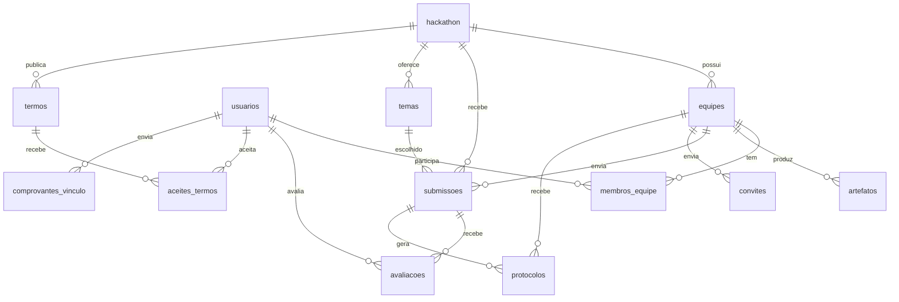

# Hackathon — Backend

API do sistema de gestão de hackathons. Feita com **FastAPI + SQLModel (async) + PostgreSQL 17 + Flyway + Poetry + Docker Compose**.

## Situação atual

- [x] Estrutura do projeto, Docker, CI
- [x] Banco: tabelas e enums (migration `V202610110000__init.sql`)
- [x] Banco: fluxos de inscrição e proposta (migration `V202610261200__fluxos_inscricao_proposta.sql`)
- [x] Banco: perfis de acesso do RF06 (migration `V202610261300__perfis_de_acesso.sql`)
- [x] Models (SQLModel) e schemas (Pydantic) de todas as entidades
- [ ] Controllers e rotas (CRUD) — por enquanto a API só tem `/health`
- [ ] Autenticação

## Rodando o projeto

Pré-requisitos: Docker com o plugin `docker compose` e `make`.

```bash
git clone https://github.com/lthiago849/hackathon-backend.git
cd hackathon-backend
make env    # cria o .env a partir do .env.example
make up     # sobe db, flyway (migrations), app e pgadmin
```

| Serviço         | Endereço                        | Acesso                                          |
|-----------------|---------------------------------|-------------------------------------------------|
| API (Swagger)   | http://localhost:8000/docs      | —                                               |
| Health          | http://localhost:8000/health    | —                                               |
| pgAdmin         | http://localhost:`PGADMIN_PORT` | `admin@example.com` / `admin`                   |
| Postgres        | `localhost:POSTGRES_PORT`       | `postgres` / `postgres`, banco `POSTGRES_DB`    |

- No pgAdmin, registre o servidor com host **`db`** e porta **`5432`** (ele roda dentro da rede do Docker).
- Pelo terminal: `make db-shell` abre o `psql` já conectado.

> **Portas ocupadas?** Se outro projeto já usa a 5432/4040/8000, mude `POSTGRES_PORT`, `PGADMIN_PORT` e `APP_PORT` no `.env` (ex.: 5434 e 4041) e rode `make up` de novo.

## Modelo de dados



| Tabela                 | Descrição                                                                                     |
|------------------------|-----------------------------------------------------------------------------------------------|
| `usuarios`             | Pessoas do sistema; `email` único, `papel`, `ativo`, instituição, curso e período; dados do mentor (empresa, área, máx. de equipes) |
| `hackathon`            | Edição do evento: datas, `status`, tamanho da equipe (`min/max_integrantes`) e prazos da Fase 1 |
| `equipes`              | Equipes de um hackathon, com a `situacao` (Em formação → Homologada)                           |
| `membros_equipe`       | Usuário ↔ equipe com a `funcao`; uma equipe por pessoa em cada hackathon e um único `LIDER`     |
| `convites`             | Integrantes informados pelo líder (nome e e-mail) aguardando confirmação                       |
| `termos`               | Regulamento e termo de consentimento, versionados; uma versão vigente por tipo                 |
| `aceites_termos`       | Aceite de um usuário a uma versão de termo, com data e hora                                    |
| `comprovantes_vinculo` | Comprovante de vínculo e a conferência do Comitê Científico; reenvio cria uma linha nova       |
| `temas`                | Temas do edital, com ODS relacionados e `ativo`                                               |
| `submissoes`           | Proposta da equipe (uma por equipe): rascunho até ser enviada com tema, ODS e bases de dados    |
| `protocolos`           | Comprovante da conclusão da inscrição e do envio da proposta (`numero` gerado pelo banco)       |
| `artefatos`            | Entregáveis da equipe (`url` externa: GitHub, Cloudinary...)                                  |
| `avaliacoes`           | Nota e comentários de um avaliador sobre uma submissão                                        |

As constraints do banco garantem as regras que dependem de uma única tabela (ex.: proposta enviada exige tema, comprovante recusado exige motivo). Regras que dependem de contagem, prazo ou perfil (3 a 5 integrantes, homologação automática, bloqueio após o prazo) ficam nos services.

Todos os IDs são **UUID** gerados pelo banco (`uuid_generate_v4()`).

### Enums

O líder técnico não é um papel: é `membros_equipe.funcao = LIDER`, porque vale por equipe.

Definidos como `ENUM` nativo no Postgres (migration) e espelhados em [`app/const/enums.py`](app/const/enums.py). Valores sempre em **MAIÚSCULO**.

| Tipo                 | Valores                                                                                         |
|----------------------|-------------------------------------------------------------------------------------------------|
| `papel_usuario`      | `PARTICIPANTE`, `MENTOR`, `COMITE_TECNICO`, `COMITE_CIENTIFICO`, `ORGANIZADOR`, `DEV` (admin técnico) |
| `status_hackathon`   | `RASCUNHO`, `INSCRICOES` (padrão), `INSCRICOES_ENCERRADAS`, `ATIVO`, `EM_AVALIACAO`, `FINALIZADO`, `CANCELADO` |
| `funcao_membro`      | `LIDER`, `DESENVOLVEDOR`, `DESIGNER`, `NEGOCIOS`, `OUTRO`                                       |
| `categoria_artefato` | `REPOSITORIO_CODIGO`, `DIAGRAMA`, `VIDEO`, `APRESENTACAO`, `DOCUMENTACAO`, `PROTOTIPO`, `OUTRO` |
| `situacao_equipe`    | `EM_FORMACAO` (padrão), `AGUARDANDO_HOMOLOGACAO`, `HOMOLOGADA`, `NAO_HOMOLOGADA`                 |
| `status_convite`     | `PENDENTE` (padrão), `ACEITO`, `RECUSADO`, `CANCELADO`                                          |
| `tipo_termo`         | `REGULAMENTO`, `TERMO_CONSENTIMENTO`                                                            |
| `status_comprovante` | `PENDENTE` (padrão), `APROVADO`, `RECUSADO`                                                     |
| `status_proposta`    | `RASCUNHO` (padrão), `ENVIADA`                                                                  |
| `tipo_protocolo`     | `INSCRICAO_EQUIPE`, `PROPOSTA`                                                                  |

Colunas preenchidas pelo banco (datas de envio/aceite, número do protocolo) usam `server_default` no model (`AGORA_UTC` em `app/db/defaults.py`), para o ORM não mandar `NULL` no insert.

Para adicionar um valor: crie uma migration nova com `ALTER TYPE <tipo> ADD VALUE '<VALOR>';` e acrescente o membro na classe correspondente em `enums.py`. Nos models, colunas enum usam o helper `pg_enum(...)`, que mapeia para o tipo criado pelo Flyway.

## Estrutura

```
.
├── app/
│   ├── main.py            # cria o FastAPI, CORS e inclui os routers
│   ├── __init__.py        # tags do Swagger
│   ├── const/             # config.py (variáveis de ambiente) e enums.py
│   ├── db/                # engine e get_session
│   ├── models/            # tabelas SQLModel (1 arquivo por tabela)
│   ├── schemas/           # Pydantic: XCreate, XUpdate, XResponse
│   ├── controllers/       # acesso ao banco (get/criar/atualizar/deletar)
│   ├── views/             # routers FastAPI; views/__init__.py agrega todos
│   ├── services/          # regras de negócio que juntam vários controllers
│   ├── validations/       # validações reutilizáveis
│   ├── security/          # autenticação/autorização
│   ├── exceptions/        # HTTPException padronizadas (404, constraint, 500)
│   ├── middlewares/
│   ├── integrations/      # clientes de APIs externas
│   ├── jobs/              # tarefas agendadas (iniciar no lifespan)
│   └── utils/             # lifespan, helpers genéricos (atualizar_instancia)
├── migrations/            # SQL do Flyway
├── tests/
├── Dockerfile             # targets: dev (compose) e prod (deploy)
├── Dockerfile.flyway      # imagem com as migrations para o deploy
├── docker-compose.yml
├── Makefile
└── pyproject.toml
```

Fluxo de uma requisição:

```
view (rota) → controller (banco) → model (tabela)
     ↑ valida entrada/saída com schemas
```

## Criando as rotas de uma entidade (ex.: `equipe`)

Model e schemas já existem; falta:

1. **Controller** — `app/controllers/equipe.py` (`get_equipe_by_id`, `criar_equipe`, `atualizar_equipe`, `deletar_equipe`), usando `app/exceptions/db.py` para os erros e `atualizar_instancia` (em `app/utils/generic_db_operations.py`) com o schema `EquipeUpdate`.
2. **View** — `app/views/equipe.py` com `router = APIRouter(prefix="/equipes", tags=["Equipes"])`, recebendo `EquipeCreate`/`EquipeUpdate` e devolvendo `EquipeResponse`.
3. Registrar o router em `app/views/__init__.py` e a tag em `app/__init__.py`.

Para uma tabela nova: migration → model em `app/models/` (e importar em `models/__init__.py`) → schemas → passos acima.

## Migrations (Flyway)

- Nome: `V<AAAAMMDDHHMM>__descricao.sql` (ex.: `V202610151530__adicionar_coluna_premio.sql`).
- **Nunca edite uma migration já aplicada**; crie uma nova. Se você subiu o banco antes de uma migration ser alterada, rode `make clean && make up` (apaga os dados locais).
- O compose roda as migrations ao subir. Para aplicar sem reiniciar: `make migrate`.

## Comandos

| Comando         | O que faz                                         |
|-----------------|---------------------------------------------------|
| `make env`      | Cria o `.env` a partir do `.env.example`          |
| `make up`       | Sobe os containers (com build)                    |
| `make down`     | Para os containers                                |
| `make restart`  | Reinicia                                          |
| `make logs`     | Acompanha os logs da API                          |
| `make migrate`  | Aplica migrations pendentes                       |
| `make test`     | Roda o pytest dentro do container                 |
| `make lint`     | Ruff (lint + checagem de formatação)              |
| `make format`   | Corrige lint e formata o código                   |
| `make shell`    | Terminal dentro do container da API               |
| `make db-shell` | psql no banco                                     |
| `make lock`     | Atualiza o `poetry.lock` após editar dependências |
| `make clean`    | Para tudo e **apaga os dados do banco**           |

Para adicionar uma dependência: edite o `pyproject.toml`, rode `make lock` e depois `make up`.

## CI/CD (GitHub Actions)

- `.github/workflows/ci.yml` — a cada push/PR em `main`/`dev`: sobe Postgres, aplica as migrations, roda ruff e pytest.
- `.github/workflows/deploy.yml` — deploy manual (workflow_dispatch) em servidor com runner self-hosted. Configure os secrets/variables listados no topo do arquivo. **Nunca coloque senhas direto no workflow.**
