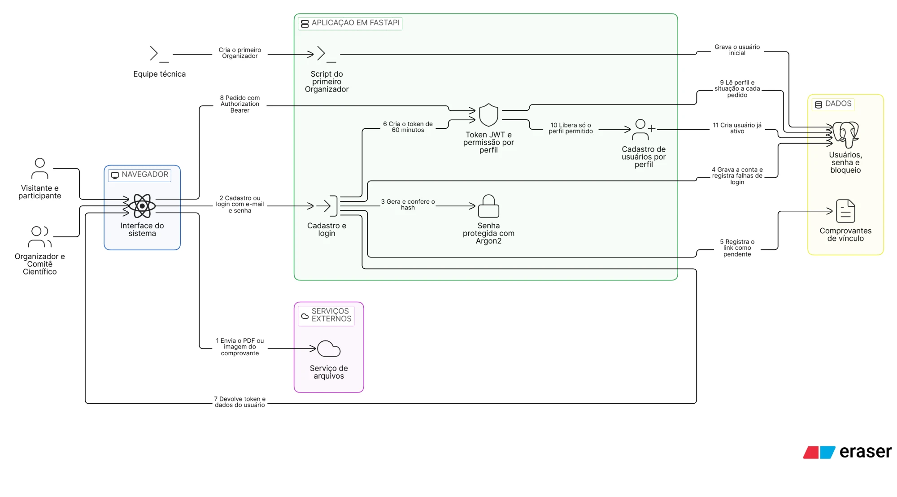
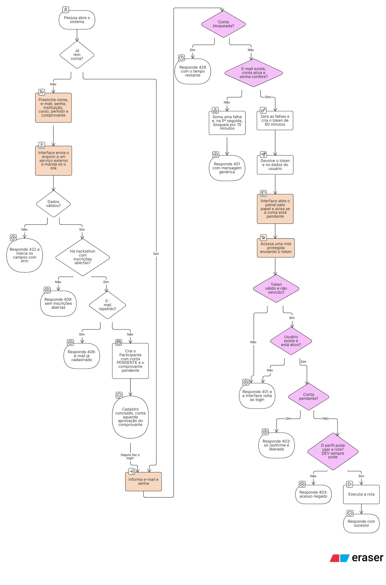

[← Voltar ao README](../README.md)

# Autenticação e permissões

O participante se cadastra, faz login e recebe um **token JWT**, que envia em todo pedido no cabeçalho `Authorization: Bearer <token>`. No Swagger, use o botão **Authorize** e cole o token.

| Rota                  | Quem acessa                                   | O que faz                                                                 |
|-----------------------|-----------------------------------------------|---------------------------------------------------------------------------|
| `POST /auth/cadastro` | Qualquer pessoa                               | Cria um **Participante** com conta pendente e registra o comprovante (RF01) |
| `POST /auth/login`    | Qualquer pessoa                               | Devolve o token de acesso e os dados do usuário (RF02)                    |
| `GET /auth/me`        | Qualquer usuário logado, inclusive conta pendente | Dados de quem está logado                                             |
| `POST /auth/recuperar-senha` | Qualquer pessoa                        | Envia o link de redefinição; a resposta é a mesma exista ou não a conta (RF04) |
| `POST /auth/redefinir-senha` | Qualquer pessoa, com o link            | Grava a nova senha e encerra todas as sessões (RF04)                      |
| `POST /auth/confirmar-email` | Qualquer pessoa, com o link            | Confirma o e-mail ou conclui a troca de endereço (RF01)                   |
| `GET /auth/sessao`    | Qualquer usuário logado, inclusive conta pendente | Quando a sessão vence, para o aviso de expiração (RF09)         |
| `POST /auth/logout`   | Qualquer usuário logado, inclusive conta pendente | Encerra todas as sessões da conta (RF09)                        |
| `GET /me`, `PATCH /me` | Qualquer usuário logado, inclusive conta pendente | Consulta e atualiza os dados permitidos do próprio perfil (RF05) |
| `POST /me/senha`      | Qualquer usuário logado                       | Troca a senha com a senha atual; devolve um token novo (RF05)             |
| `POST /me/email`      | Qualquer usuário logado                       | Pede a troca do e-mail, com a senha atual; vale só após confirmar o novo endereço |
| `POST /me/confirmacao-email` | Qualquer usuário logado                | Reenvia o link de confirmação do e-mail atual                             |
| `GET /admin/usuarios/perfis` | Organizador e Comitê Científico (e DEV) | Perfis que o usuário logado pode cadastrar                             |
| `POST /admin/usuarios` | Organizador e Comitê Científico (e DEV)      | Cadastra usuários de outros perfis, conforme a hierarquia abaixo (RF07, RF08) |
| `GET /admin/usuarios`, `GET /admin/usuarios/{id}` | Organizador e Comitê Científico (e DEV) | Lista (filtros e paginação) e consulta os perfis do seu alcance (RN24) |
| `PATCH /admin/usuarios/{id}` | Organizador e Comitê Científico (e DEV) | Edita dados pessoais e, só entre perfis de gestão, o perfil (RN24)       |
| `POST /admin/usuarios/{id}/desativar`, `.../reativar` | Organizador e Comitê Científico (e DEV) | Desativa ou reativa uma conta do seu alcance (RN24)        |

**Cadastro.** Exige nome, e-mail, instituição, curso, período, senha e o link do comprovante de vínculo (`https`, terminando em `.pdf`, `.png`, `.jpg` ou `.jpeg`; o arquivo fica em um serviço externo como o Cloudinary). A senha precisa de 8 a 128 caracteres, com pelo menos uma letra e um número. O e-mail é guardado em minúsculas e não pode repetir. O perfil nunca vem do cliente. O comprovante é ligado ao hackathon com inscrições abertas (`status = INSCRICOES`); sem nenhum, o cadastro responde 409. A conta nasce `PENDENTE` e só passa a `ATIVA` quando o Comitê Científico aprovar o comprovante (RN25, tarefa futura).

**Login.** Credenciais inválidas (e-mail inexistente, senha errada ou conta desativada) dão sempre a mesma resposta 401, sem dizer qual dado errou. Depois de `LOGIN_MAX_TENTATIVAS` falhas seguidas a conta fica bloqueada por `LOGIN_BLOQUEIO_MINUTOS`: nesse período até a senha correta é recusada, com 429 e o cabeçalho `Retry-After`. Um login correto zera o contador. O token vale `JWT_EXPIRE_MINUTES` e não é renovado: passado o prazo, é preciso entrar de novo.

**Sessão (RF09).** O token é um JWT sem estado no servidor e carrega, além do id, a **versão da sessão** (`sv`) da conta (`usuarios.versao_sessao`). A API compara essa versão com a do banco a cada pedido: se forem diferentes, responde 401. Aumentar a versão encerra de uma vez **todos** os tokens da conta, de todos os aparelhos, e isso acontece em `POST /auth/logout`, na troca e na redefinição de senha e na desativação da conta. Tokens emitidos antes desta entrega, sem `sv`, valem como versão 0. O token continua sem renovação: `GET /auth/sessao` devolve `segundos_restantes` para a interface avisar antes de vencer.

**Perfil próprio (RF05).** `PATCH /me` altera só o que a pessoa pode controlar: nome, instituição, curso e período; Mentor também empresa e área de atuação. Qualquer outro campo (`papel`, `ativo`, `situacao_conta`, `email`, `max_equipes`...) dá **422**, e `null` também: ninguém altera o próprio perfil de acesso nem a capacidade de mentoria. Trocar a senha (`POST /me/senha`) e o e-mail (`POST /me/email`) exige a **senha atual**. Uma senha atual errada dá **403** (a sessão continua válida) e conta para o bloqueio de tentativas, como no login: um token roubado não serve para adivinhar a senha.

**Recuperação de senha (RF04).** `POST /auth/recuperar-senha` responde sempre **202** com a mesma mensagem, exista ou não conta com o e-mail (RNF14 a RNF17). Se a conta existir e puder entrar, o e-mail `RECUPERACAO_SENHA` leva um link de uso único (`FRONTEND_URL/redefinir-senha#token=...`, no fragmento, para o token não ir a logs de servidor) que vale `SENHA_RESET_MINUTOS`. Não recebem e-mail: endereço sem conta, conta desativada e conta sem senha (mentor que ainda não concluiu o convite). Um novo pedido gasta o link anterior, e pedidos dentro de `SENHA_RESET_INTERVALO_SEGUNDOS` não geram outro e-mail. `POST /auth/redefinir-senha` grava a senha (mesma regra do cadastro), encerra as sessões, libera um bloqueio por tentativas e confirma o e-mail. Link inexistente, vencido ou já usado dá sempre o mesmo **400**. Dois usos simultâneos do mesmo link resultam em um 204 e um 400. O banco guarda só o SHA-256 do token (`tokens_usuario`), nunca o valor.

**Confirmação de e-mail (RF01).** O cadastro público envia o e-mail `CONFIRMACAO_EMAIL`; `POST /auth/confirmar-email` não exige login (o link costuma abrir em outro aparelho) e preenche `email_confirmado_em`. A confirmação é **informativa**: não bloqueia o login nem nenhuma rota, para não derrubar as contas existentes. Na troca de e-mail, o link vai ao **novo** endereço e a conta só passa a usá-lo quando ele for aberto; se outra conta tomar o endereço no meio do caminho, a confirmação dá 409. Quem ativou a conta por convite (mentor, RN33) já consta como confirmado. `POST /me/confirmacao-email` reenvia o link.

**Gestão de usuários (RN24).** Quem pode cadastrar um perfil (tabela abaixo) também pode **listar, editar, desativar e reativar** esse perfil, e só ele: o Comitê Científico alcança Comitê Técnico e Mentor, o Organizador todos menos DEV. Regras:

- Troca de perfil só entre Comitê Técnico, Comitê Científico e Organizador (409 nos demais casos), e ninguém entrega um perfil acima do próprio alcance (403). O Comitê Científico, portanto, não promove ninguém.
- Ninguém altera o próprio perfil nem desativa a própria conta pelas rotas administrativas (409).
- O sistema nunca fica sem Organizador ativo: desativar ou rebaixar o último dá 409. Operações simultâneas são serializadas por um bloqueio do banco, então duas desativações cruzadas dos dois últimos Organizadores resultam em uma só.
- Desativar bloqueia o acesso na hora (o token passa a dar 401), encerra as sessões e gasta os links pendentes; o histórico é preservado. Reativar devolve o acesso com a senha que a pessoa já tinha.
- **Mentores** ficam de fora: editar, desativar e reativar um Mentor responde 409 e aponta para `/admin/mentores`, porque a reativação confere os termos da edição (RN33).
- O e-mail não é editado pelo gestor: quem troca é o dono, com confirmação.
- Fora do alcance do gestor, a lista vem filtrada e as rotas por id respondem 403.

**Perfis (RF06).** A ordem Organizador, Comitê Científico, Mentor, Comitê Técnico, Líder e Membro define só quem cadastra quem; não há herança de permissões. O líder técnico não é um perfil: é `membros_equipe.funcao = LIDER`.

| Perfil               | Pode cadastrar                                    |
|----------------------|---------------------------------------------------|
| `ORGANIZADOR`        | Qualquer perfil, menos `DEV`                      |
| `COMITE_CIENTIFICO`  | `COMITE_TECNICO` e `MENTOR`                       |
| `MENTOR`, `COMITE_TECNICO`, `PARTICIPANTE` | Nenhum                      |
| `DEV`                | Qualquer perfil, e acessa todas as rotas          |

**Protegendo uma rota.** As dependências ficam em `app/security/dependencias.py`. O perfil e a situação da conta são lidos do banco a cada pedido (o token guarda só o id), então desativar uma conta ou trocar o perfil vale na hora.

```python
from app.security.dependencias import exigir_papeis, usuario_ativo, usuario_atual


# Só os perfis listados (DEV sempre passa). Conta pendente recebe 403.
@router.post("")
async def criar(usuario: Usuario = Depends(exigir_papeis(PapelUsuario.ORGANIZADOR))): ...


# Qualquer usuário com conta ativa
@router.get("")
async def listar(usuario: Usuario = Depends(usuario_ativo)): ...


# Qualquer usuário logado, até com conta pendente (usado em /auth/me)
@router.get("/eu")
async def eu(usuario: Usuario = Depends(usuario_atual)): ...
```

Respostas: sem token, token inválido, vencido ou de conta desativada dão **401**; token válido sem permissão, ou conta pendente em rota que exige conta ativa, dão **403**.

**Variáveis de ambiente** (no `.env.example`):

| Variável                 | Padrão | Descrição                                                              |
|--------------------------|--------|------------------------------------------------------------------------|
| `JWT_SECRET`             | —      | Chave que assina os tokens, mínimo de 32 caracteres. **Obrigatória**: a API não sobe sem ela. Em produção use um valor próprio e secreto |
| `JWT_EXPIRE_MINUTES`     | `60`   | Validade do token                                                      |
| `LOGIN_MAX_TENTATIVAS`   | `5`    | Falhas seguidas até bloquear a conta                                   |
| `LOGIN_BLOQUEIO_MINUTOS` | `15`   | Duração do bloqueio                                                    |
| `SENHA_RESET_MINUTOS`    | `30`   | Validade do link de redefinição de senha                               |
| `SENHA_RESET_INTERVALO_SEGUNDOS` | `60` | Intervalo mínimo entre dois pedidos de redefinição (e de reenvio da confirmação) da mesma conta; `0` desliga |
| `EMAIL_CONFIRMACAO_MINUTOS` | `1440` | Validade do link de confirmação de e-mail                            |

**Primeiro Organizador.** Como só o Organizador cadastra os demais perfis, o primeiro usuário é criado por um script, dentro do container da API (a senha é pedida no terminal e não fica no histórico):

```bash
docker compose exec app python -m app.scripts.criar_usuario --email organizador@ufpa.br --nome "Nome Completo" --papel ORGANIZADOR
```

O acesso de mentores por convite temporário está implementado em [Mentores](mentores.md) (RN33, BE-S5-10), com o template e a fila do PR #15. Perfil, recuperação de senha, confirmação de e-mail e gestão de contas são a BE-S5-07, descritos acima. **Login social (Google/GitHub, Q17) não foi implementado**: depende de decisão e validação do grupo.

## Diagramas da autenticação

**Arquitetura.** Como o navegador, a API, o banco e o serviço de arquivos se falam no cadastro, no login e a cada pedido protegido. Os números seguem a ordem dos passos.



**Fluxograma.** O caminho de uma pessoa do cadastro até uma rota protegida, com todas as respostas de erro. Laranja é ação da pessoa ou da interface, roxo é verificação de segurança da API e branco é processamento do sistema.



## Guia para a interface (front)

O Swagger em `/docs` descreve cada rota, os campos e os erros possíveis e serve de contrato. Em resumo, o que a interface faz:

**1. Cadastro do participante** (tela pública). Envia o comprovante (PDF ou imagem, até 10 MB) para um serviço externo, como o Cloudinary, e manda só o link:

```
POST /auth/cadastro
{ "nome": "Ana Souza", "email": "ana@ufpa.br", "senha": "segredo123",
  "instituicao": "UFPA", "curso": "Sistemas de Informação", "periodo": 5,
  "comprovante_url": "https://res.cloudinary.com/.../comprovante.pdf" }
→ 201  { "id": "...", "email": "ana@ufpa.br", "papel": "PARTICIPANTE", "situacao_conta": "PENDENTE", ... }
```

**2. Login.** A resposta já traz o usuário, então não é preciso chamar `/auth/me` depois. A interface guarda o `access_token` e o envia em todo pedido protegido como `Authorization: Bearer <token>`:

```
POST /auth/login
{ "email": "ana@ufpa.br", "senha": "segredo123" }
→ 200  { "access_token": "eyJ...", "token_type": "bearer", "expires_in": 3600,
         "usuario": { "id": "...", "nome": "Ana Souza", "papel": "PARTICIPANTE",
                      "situacao_conta": "PENDENTE", "ativo": true, ... } }
```

**3. Painel e menus.** O painel vem do `usuario.papel` (`PARTICIPANTE`, `MENTOR`, `COMITE_TECNICO`, `COMITE_CIENTIFICO`, `ORGANIZADOR` ou `DEV`). Esconder um menu é só conforto: a API recusa com 403 qualquer rota que o perfil não possa usar. O líder técnico não é um papel; ele vem de `membros_equipe.funcao`.

**4. Conta pendente.** Se `usuario.situacao_conta` for `PENDENTE`, mostre "aguardando validação do comprovante" e não abra as outras telas: a conta só consegue `GET /auth/me`, e as demais rotas protegidas respondem 403.

**5. Tela "Cadastrar usuário"** (Organizador e Comitê Científico). Monte a lista de perfis com `GET /admin/usuarios/perfis`, sem copiar a hierarquia no front. Os demais perfis exigem senha inicial; para mentor, envie os cinco campos do cadastro, sem senha. A conta de mentor nasce inativa e o destinatário recebe um convite para concluir o próprio perfil e aceitar os termos:

```
GET /admin/usuarios/perfis      → 200  { "perfis": ["COMITE_TECNICO", "MENTOR"] }
POST /admin/usuarios
{ "email": "mentor@acaivalley.com", "nome": "Maria Souza", "papel": "MENTOR",
  "empresa_parceira": "Açaí Valley", "area_atuacao": "Dados", "max_equipes": 2,
  "hackathon_id": "UUID_DA_EDICAO_DO_CONVITE" }
→ 201  (ativo=false; convite RN33 enfileirado)
```

**6. Esqueci a senha e confirmação de e-mail** (telas públicas). Os links dos e-mails levam o token no **fragmento** da URL (`#token=...`); a interface o lê, remove da barra de endereço e o envia no corpo:

```
POST /auth/recuperar-senha   { "email": "ana@ufpa.br" }                      → 202  { "detail": "Se existir uma conta..." }
POST /auth/redefinir-senha   { "token": "<do link>", "senha_nova": "..." }   → 204  (sessões antigas caem; entrar de novo)
POST /auth/confirmar-email   { "token": "<do link>" }                        → 200  { ...usuario, "email_confirmado_em": "..." }
```

Mostre sempre a mesma mensagem no pedido de recuperação, tenha ou não conta. Com `email_confirmado_em` nulo, a interface pode mostrar um aviso com o botão que chama `POST /me/confirmacao-email`. Depois de `POST /me/senha`, troque o token guardado pelo `access_token` da resposta.

**Erros.** Todos vêm como `{ "detail": "mensagem" }`, exceto o 422, em que `detail` é uma lista com `loc` (o campo) e `msg`:

| Código | Quando                                                                                   | O que a interface faz                                  |
|--------|------------------------------------------------------------------------------------------|--------------------------------------------------------|
| 400    | Link de redefinição ou de confirmação inválido, vencido ou já usado                      | Mostra "link inválido" e oferece pedir outro           |
| 401    | Sem token, token inválido, vencido (60 min) ou encerrado (logout, troca de senha), conta desativada, ou e-mail/senha errados | Volta para o login |
| 403    | Perfil sem permissão, conta pendente em rota que exige conta ativa, ou **senha atual incorreta** em `/me/senha` e `/me/email` | Mostra acesso negado, ou "senha atual incorreta" nas rotas de senha e e-mail |
| 409    | E-mail já cadastrado, ou nenhum hackathon com inscrições abertas (cadastro público)      | Mostra a mensagem do `detail`                          |
| 422    | Campo inválido, como senha fraca ou link do comprovante fora do formato                   | Marca o campo indicado em `loc`                        |
| 429    | Conta bloqueada por 5 senhas erradas seguidas (15 minutos)                               | Mostra "conta bloqueada, tente novamente mais tarde"   |

**Pontos de atenção:**
- O token não é renovado: depois de `expires_in` segundos o próximo pedido dá 401 e é preciso entrar de novo.
- No 429 a API manda o tempo restante no cabeçalho `Retry-After`. O navegador só deixa o front ler esse cabeçalho se ele for exposto no CORS, o que ainda não foi configurado; enquanto isso, use a mensagem fixa acima.
- Para o front rodar em outra origem, defina `CORS_ORIGINS` no `.env` da API (hoje o padrão é `*`).
- A conta de participante do cadastro público fica `PENDENTE` até um Organizador ou o Comitê Científico aprovar o comprovante (`POST /admin/comprovantes/{id}/aprovar`). Mentor não exige comprovante: fica `ativo=false` até concluir o fluxo de [convite e ativação](mentores.md). Alterar somente `situacao_conta` não conclui a RN33.

---

[← Voltar ao README](../README.md)
