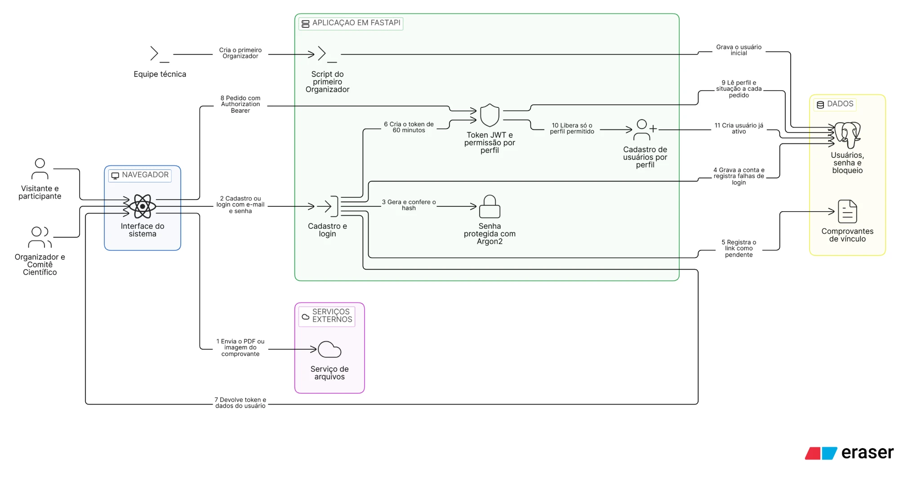
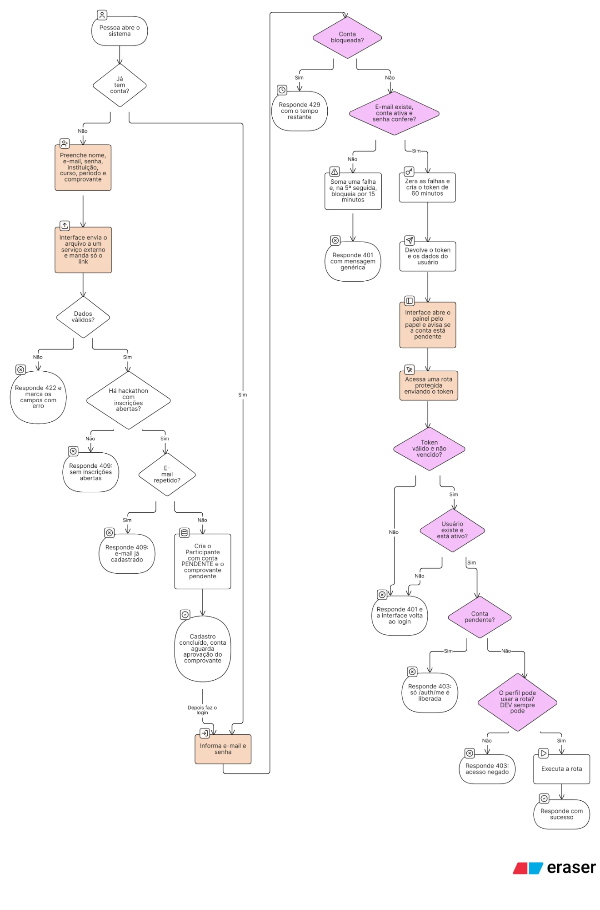

[← Voltar ao README](../README.md)

# Autenticação e permissões

O participante se cadastra, faz login e recebe um **token JWT**, que envia em todo pedido no cabeçalho `Authorization: Bearer <token>`. No Swagger, use o botão **Authorize** e cole o token.

| Rota                  | Quem acessa                                   | O que faz                                                                 |
|-----------------------|-----------------------------------------------|---------------------------------------------------------------------------|
| `POST /auth/cadastro` | Qualquer pessoa                               | Cria um **Participante** com conta pendente e registra o comprovante (RF01) |
| `POST /auth/login`    | Qualquer pessoa                               | Devolve o token de acesso e os dados do usuário (RF02)                    |
| `GET /auth/me`        | Qualquer usuário logado, inclusive conta pendente | Dados de quem está logado                                             |
| `GET /admin/usuarios/perfis` | Organizador e Comitê Científico (e DEV) | Perfis que o usuário logado pode cadastrar                             |
| `POST /admin/usuarios` | Organizador e Comitê Científico (e DEV)      | Cadastra usuários de outros perfis, conforme a hierarquia abaixo (RF07, RF08) |

**Cadastro.** Exige nome, e-mail, instituição, curso, período, senha e o link do comprovante de vínculo (`https`, terminando em `.pdf`, `.png`, `.jpg` ou `.jpeg`; o arquivo fica em um serviço externo como o Cloudinary). A senha precisa de 8 a 128 caracteres, com pelo menos uma letra e um número. O e-mail é guardado em minúsculas e não pode repetir. O perfil nunca vem do cliente. O comprovante é ligado ao hackathon com inscrições abertas (`status = INSCRICOES`); sem nenhum, o cadastro responde 409. A conta nasce `PENDENTE` e só passa a `ATIVA` quando o Comitê Científico aprovar o comprovante (RN25, tarefa futura).

**Login.** Credenciais inválidas (e-mail inexistente, senha errada ou conta desativada) dão sempre a mesma resposta 401, sem dizer qual dado errou. Depois de `LOGIN_MAX_TENTATIVAS` falhas seguidas a conta fica bloqueada por `LOGIN_BLOQUEIO_MINUTOS`: nesse período até a senha correta é recusada, com 429 e o cabeçalho `Retry-After`. Um login correto zera o contador. O token vale `JWT_EXPIRE_MINUTES` e não é renovado: passado o prazo, é preciso entrar de novo.

**Perfis (RF06).** A ordem Organizador, Comitê Científico, Mentor, Comitê Técnico, Líder e Membro define só quem cadastra quem; não há herança de permissões. O líder técnico não é um perfil: é `membros_equipe.funcao = LIDER`.

| Perfil               | Pode cadastrar                                    |
|----------------------|---------------------------------------------------|
| `ORGANIZADOR`        | Qualquer perfil, menos `DEV`                      |
| `COMITE_CIENTIFICO`  | `COMITE_TECNICO` e `MENTOR`                       |
| `MENTOR`, `COMITE_TECNICO`, `PARTICIPANTE` | Nenhum                      |
| `DEV`                | Qualquer perfil, e acessa todas as rotas          |

**Protegendo uma rota.** As dependências ficam em `app/security/dependencias.py`. O perfil e a situação da conta são lidos do banco a cada pedido (o token guarda só o id), então desativar uma conta ou trocar o perfil vale na hora.

```python
from app.security.dependencias import exigir_papeis, usuario_ativo, usuario_atual


# Só os perfis listados (DEV sempre passa). Conta pendente recebe 403.
@router.post("")
async def criar(usuario: Usuario = Depends(exigir_papeis(PapelUsuario.ORGANIZADOR))): ...


# Qualquer usuário com conta ativa
@router.get("")
async def listar(usuario: Usuario = Depends(usuario_ativo)): ...


# Qualquer usuário logado, até com conta pendente (usado em /auth/me)
@router.get("/eu")
async def eu(usuario: Usuario = Depends(usuario_atual)): ...
```

Respostas: sem token, token inválido, vencido ou de conta desativada dão **401**; token válido sem permissão, ou conta pendente em rota que exige conta ativa, dão **403**.

**Variáveis de ambiente** (no `.env.example`):

| Variável                 | Padrão | Descrição                                                              |
|--------------------------|--------|------------------------------------------------------------------------|
| `JWT_SECRET`             | —      | Chave que assina os tokens, mínimo de 32 caracteres. **Obrigatória**: a API não sobe sem ela. Em produção use um valor próprio e secreto |
| `JWT_EXPIRE_MINUTES`     | `60`   | Validade do token                                                      |
| `LOGIN_MAX_TENTATIVAS`   | `5`    | Falhas seguidas até bloquear a conta                                   |
| `LOGIN_BLOQUEIO_MINUTOS` | `15`   | Duração do bloqueio                                                    |

**Primeiro Organizador.** Como só o Organizador cadastra os demais perfis, o primeiro usuário é criado por um script, dentro do container da API (a senha é pedida no terminal e não fica no histórico):

```bash
docker compose exec app python -m app.scripts.criar_usuario --email organizador@ufpa.br --nome "Nome Completo" --papel ORGANIZADOR
```

Ficou de fora desta etapa: confirmação do e-mail, envio de acesso por e-mail, recuperação de senha, login com Google/GitHub, encerrar sessão e a aprovação do comprovante pelo Comitê Científico.

## Diagramas da autenticação

**Arquitetura.** Como o navegador, a API, o banco e o serviço de arquivos se falam no cadastro, no login e a cada pedido protegido. Os números seguem a ordem dos passos.



**Fluxograma.** O caminho de uma pessoa do cadastro até uma rota protegida, com todas as respostas de erro. Laranja é ação da pessoa ou da interface, roxo é verificação de segurança da API e branco é processamento do sistema.



## Guia para a interface (front)

O Swagger em `/docs` descreve cada rota, os campos e os erros possíveis e serve de contrato. Em resumo, o que a interface faz:

**1. Cadastro do participante** (tela pública). Envia o comprovante (PDF ou imagem, até 10 MB) para um serviço externo, como o Cloudinary, e manda só o link:

```
POST /auth/cadastro
{ "nome": "Ana Souza", "email": "ana@ufpa.br", "senha": "segredo123",
  "instituicao": "UFPA", "curso": "Sistemas de Informação", "periodo": 5,
  "comprovante_url": "https://res.cloudinary.com/.../comprovante.pdf" }
→ 201  { "id": "...", "email": "ana@ufpa.br", "papel": "PARTICIPANTE", "situacao_conta": "PENDENTE", ... }
```

**2. Login.** A resposta já traz o usuário, então não é preciso chamar `/auth/me` depois. A interface guarda o `access_token` e o envia em todo pedido protegido como `Authorization: Bearer <token>`:

```
POST /auth/login
{ "email": "ana@ufpa.br", "senha": "segredo123" }
→ 200  { "access_token": "eyJ...", "token_type": "bearer", "expires_in": 3600,
         "usuario": { "id": "...", "nome": "Ana Souza", "papel": "PARTICIPANTE",
                      "situacao_conta": "PENDENTE", "ativo": true, ... } }
```

**3. Painel e menus.** O painel vem do `usuario.papel` (`PARTICIPANTE`, `MENTOR`, `COMITE_TECNICO`, `COMITE_CIENTIFICO`, `ORGANIZADOR` ou `DEV`). Esconder um menu é só conforto: a API recusa com 403 qualquer rota que o perfil não possa usar. O líder técnico não é um papel; ele vem de `membros_equipe.funcao`.

**4. Conta pendente.** Se `usuario.situacao_conta` for `PENDENTE`, mostre "aguardando validação do comprovante" e não abra as outras telas: a conta só consegue `GET /auth/me`, e as demais rotas protegidas respondem 403.

**5. Tela "Cadastrar usuário"** (Organizador e Comitê Científico). Monte a lista de perfis com `GET /admin/usuarios/perfis`, sem copiar a hierarquia no front, e envie o formulário para `POST /admin/usuarios` com o `papel` escolhido e a senha inicial:

```
GET /admin/usuarios/perfis      → 200  { "perfis": ["COMITE_TECNICO", "MENTOR"] }
POST /admin/usuarios
{ "email": "mentor@acaivalley.com", "nome": "Maria Souza", "papel": "MENTOR",
  "senha": "senhaInicial1", "empresa_parceira": "Açaí Valley", "max_equipes": 2 }
→ 201  (a conta já nasce ativa)
```

**Erros.** Todos vêm como `{ "detail": "mensagem" }`, exceto o 422, em que `detail` é uma lista com `loc` (o campo) e `msg`:

| Código | Quando                                                                                   | O que a interface faz                                  |
|--------|------------------------------------------------------------------------------------------|--------------------------------------------------------|
| 401    | Sem token, token inválido ou vencido (60 min), conta desativada, ou e-mail/senha errados | Volta para o login                                     |
| 403    | Perfil sem permissão, ou conta pendente em rota que exige conta ativa                    | Mostra acesso negado                                   |
| 409    | E-mail já cadastrado, ou nenhum hackathon com inscrições abertas (cadastro público)      | Mostra a mensagem do `detail`                          |
| 422    | Campo inválido, como senha fraca ou link do comprovante fora do formato                   | Marca o campo indicado em `loc`                        |
| 429    | Conta bloqueada por 5 senhas erradas seguidas (15 minutos)                               | Mostra "conta bloqueada, tente novamente mais tarde"   |

**Pontos de atenção:**
- O token não é renovado: depois de `expires_in` segundos o próximo pedido dá 401 e é preciso entrar de novo.
- No 429 a API manda o tempo restante no cabeçalho `Retry-After`. O navegador só deixa o front ler esse cabeçalho se ele for exposto no CORS, o que ainda não foi configurado; enquanto isso, use a mensagem fixa acima.
- Para o front rodar em outra origem, defina `CORS_ORIGINS` no `.env` da API (hoje o padrão é `*`).
- Uma conta nova fica `PENDENTE` até um Organizador ou o Comitê Científico aprovar o comprovante (`POST /admin/comprovantes/{id}/aprovar`). Para testar telas que exigem conta ativa sem esse passo, ative-a no banco: `UPDATE usuarios SET situacao_conta = 'ATIVA' WHERE email = '...'`.

---

[← Voltar ao README](../README.md)
