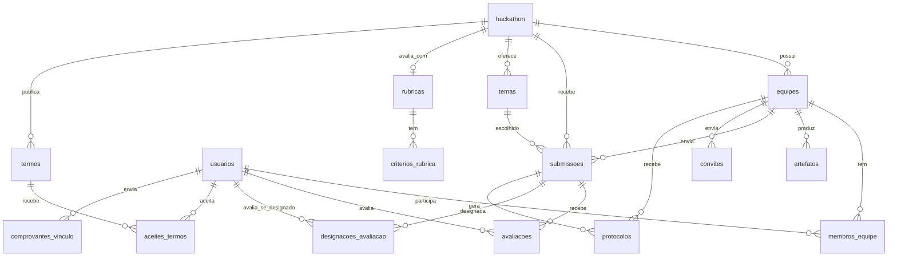

[← Voltar ao README](../README.md)

# Banco de dados

## Modelo de dados

| Tabela                 | Descrição                                                                                     |
|------------------------|-----------------------------------------------------------------------------------------------|
| `usuarios`             | Pessoas do sistema; `email` único, `papel`, `ativo`, instituição, curso e período; dados do mentor (empresa, área, máx. de equipes); `senha_hash` (Argon2), `tentativas_login`, `bloqueado_ate` e `situacao_conta` |
| `hackathon`            | Edição do evento: datas, `status`, tamanho da equipe (`min/max_integrantes`), prazos da Fase 1 e `avaliadores_por_proposta` (2 a 3, sem padrão) |
| `equipes`              | Equipes de um hackathon, com a `situacao` (Em formação → Homologada)                           |
| `membros_equipe`       | Usuário ↔ equipe com a `funcao`; uma equipe por pessoa em cada hackathon e um único `LIDER`     |
| `convites`             | Integrantes informados pelo líder (nome e e-mail) aguardando confirmação                       |
| `termos`               | Regulamento e termo de consentimento, versionados; uma versão vigente por tipo                 |
| `aceites_termos`       | Aceite de um usuário a uma versão de termo, com data e hora                                    |
| `comprovantes_vinculo` | Comprovante de vínculo e a conferência do Comitê Científico; reenvio cria uma linha nova       |
| `temas`                | Temas do edital, com ODS relacionados e `ativo`                                               |
| `rubricas`             | Rubrica de avaliação da edição (uma por hackathon); `publicada_em` preenchida a torna imutável |
| `criterios_rubrica`    | Critérios da rubrica: nome, descrição, peso (%), escala mínima e máxima e ordem de exibição    |
| `submissoes`           | Proposta da equipe (uma por equipe): rascunho até ser enviada com tema, ODS e bases de dados    |
| `protocolos`           | Comprovante da conclusão da inscrição e do envio da proposta (`numero` gerado pelo banco)       |
| `artefatos`            | Entregáveis da equipe (`url` externa: GitHub, Cloudinary...)                                  |
| `avaliacoes`           | Nota e comentários de um avaliador sobre uma submissão                                        |
| `designacoes_avaliacao` | Proposta designada a um avaliador (RF29); `unique(submissao_id, avaliador_id)`. A nota continua em `avaliacoes` |

As constraints do banco garantem as regras que dependem de uma única tabela (ex.: proposta enviada exige tema, comprovante recusado exige motivo). Regras que dependem de contagem, prazo ou perfil (3 a 5 integrantes, homologação automática, bloqueio após o prazo) ficam nos services.

Todos os IDs são **UUID** gerados pelo banco (`uuid_generate_v4()`).

## Enums

O líder técnico não é um papel: é `membros_equipe.funcao = LIDER`, porque vale por equipe.

Definidos como `ENUM` nativo no Postgres (migration) e espelhados em [`app/const/enums.py`](../app/const/enums.py). Valores sempre em **MAIÚSCULO**.

| Tipo                 | Valores                                                                                         |
|----------------------|-------------------------------------------------------------------------------------------------|
| `papel_usuario`      | `PARTICIPANTE`, `MENTOR`, `COMITE_TECNICO`, `COMITE_CIENTIFICO`, `ORGANIZADOR`, `DEV` (time de desenvolvimento: acesso a todas as rotas) |
| `status_hackathon`   | `RASCUNHO`, `INSCRICOES` (padrão), `INSCRICOES_ENCERRADAS`, `ATIVO`, `EM_AVALIACAO`, `FINALIZADO`, `CANCELADO` |
| `funcao_membro`      | `LIDER`, `DESENVOLVEDOR`, `DESIGNER`, `NEGOCIOS`, `OUTRO`                                       |
| `categoria_artefato` | `REPOSITORIO_CODIGO`, `DIAGRAMA`, `VIDEO`, `APRESENTACAO`, `DOCUMENTACAO`, `PROTOTIPO`, `OUTRO` |
| `situacao_equipe`    | `EM_FORMACAO` (padrão), `AGUARDANDO_HOMOLOGACAO`, `HOMOLOGADA`, `NAO_HOMOLOGADA`                 |
| `status_convite`     | `PENDENTE` (padrão), `ACEITO`, `RECUSADO`, `CANCELADO`                                          |
| `tipo_termo`         | `REGULAMENTO`, `TERMO_CONSENTIMENTO`                                                            |
| `status_comprovante` | `PENDENTE` (padrão), `APROVADO`, `RECUSADO`                                                     |
| `situacao_conta`     | `ATIVA` (padrão), `PENDENTE` (participante até o comprovante ser aprovado)                      |
| `status_proposta`    | `RASCUNHO` (padrão), `ENVIADA`                                                                  |
| `tipo_protocolo`     | `INSCRICAO_EQUIPE`, `PROPOSTA`                                                                  |

Colunas preenchidas pelo banco (datas de envio/aceite, número do protocolo) usam `server_default` no model (`AGORA_UTC` em `app/db/defaults.py`), para o ORM não mandar `NULL` no insert.

Para adicionar um valor: crie uma migration nova com `ALTER TYPE <tipo> ADD VALUE '<VALOR>';` e acrescente o membro na classe correspondente em `enums.py`. Nos models, colunas enum usam o helper `pg_enum(...)`, que mapeia para o tipo criado pelo Flyway.

## Migrations (Flyway)

- Nome: `V<AAAAMMDDHHMM>__descricao.sql` (ex.: `V202610151530__adicionar_coluna_premio.sql`).
- **Nunca edite uma migration já aplicada**; crie uma nova. Se você subiu o banco antes de uma migration ser alterada, rode `make clean && make up` (apaga os dados locais).
- O compose roda as migrations ao subir, no banco de desenvolvimento e no de testes. Para aplicar sem reiniciar: `make migrate`.

---

[← Voltar ao README](../README.md)
